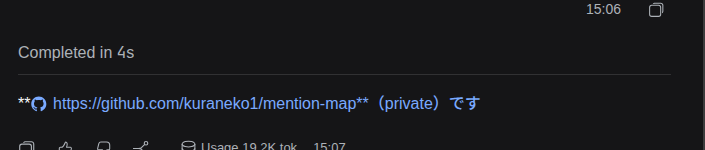
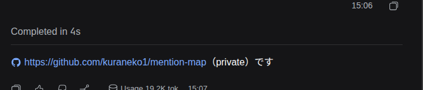

# rdsh-markdown-cjk

URL の直後に日本語が続いても、リンクが壊れないようにする DSH Web プラグインです。
`**https://example.com**（メモ）` のような太字も正しく閉じます。

## インストール

```sh
dsh plugin --profile web add github:kuraneko1/rdsh-markdown-cjk
```

追加したあと DSH を再起動してください。

無効にするときは、プロファイルの `cordis.patch.yml` で
`config: { enabled: false }`、または環境変数 `RDSH_MARKDOWN_CJK=0`。

## 変更前 / 変更後

| 変更前 | 変更後 |
| --- | --- |
|  |  |

## Install (English)

CJK prose directly after a URL keeps its link instead of being swallowed into it
(`https://example.com（memo）`, `**https://example.com**です`).

```sh
dsh plugin --profile web add github:kuraneko1/rdsh-markdown-cjk
```

Restart DSH. Disable with `RDSH_MARKDOWN_CJK=0` or `config: { enabled: false }`.

## How it works

The renderer ships prebuilt in `@deepseek-ai/dsh-web-frontend`, so the plugin
patches its vendor chunk **at serve time** and serves it from
`/markdown-cjk/v1/`. A new DSH build or a new patch version is a new URL, so
nothing goes stale; a chunk whose shape no longer matches is served untouched
(stock rendering, one log line).

Japanese text: フロントエンドの vendor チャンクを配信時にパッチして
`/markdown-cjk/v1/` から返します。DSH を更新しても起動時に再計算し、
形が変わったときは無加工で配信します（アプリは壊れません）。
